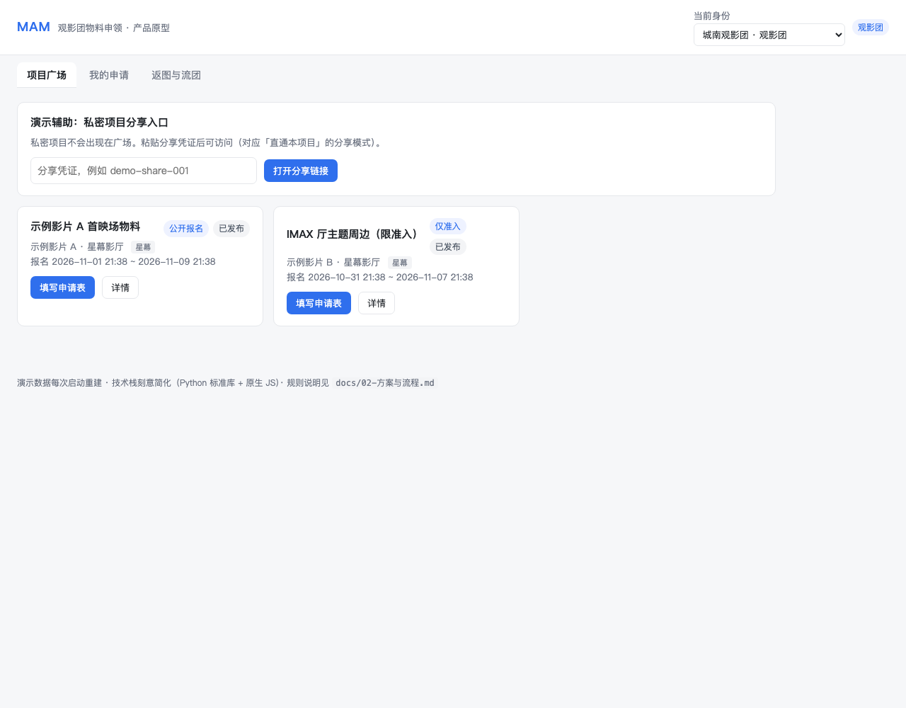
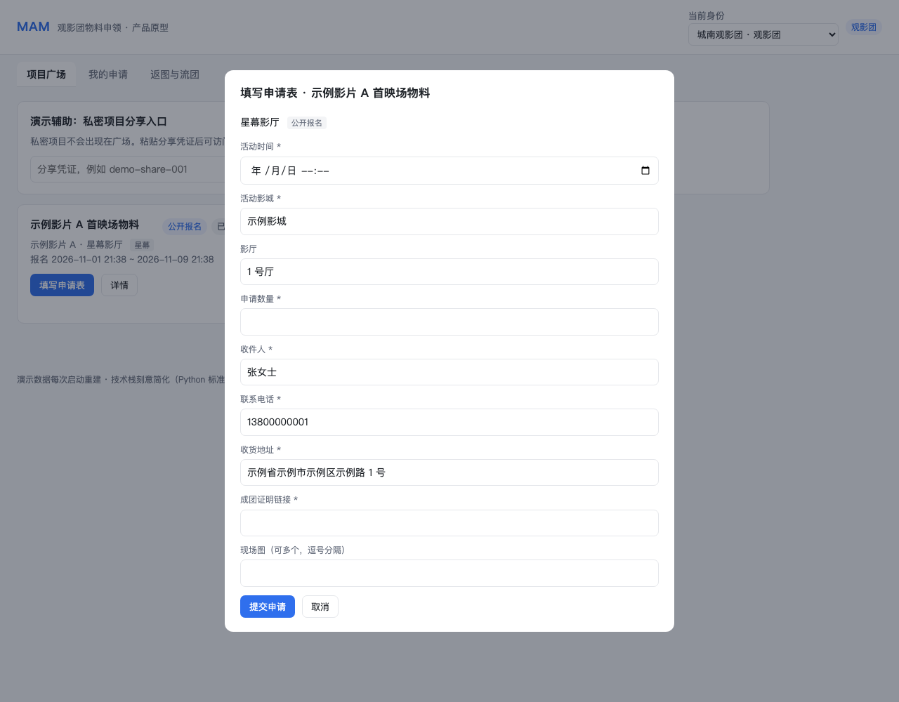
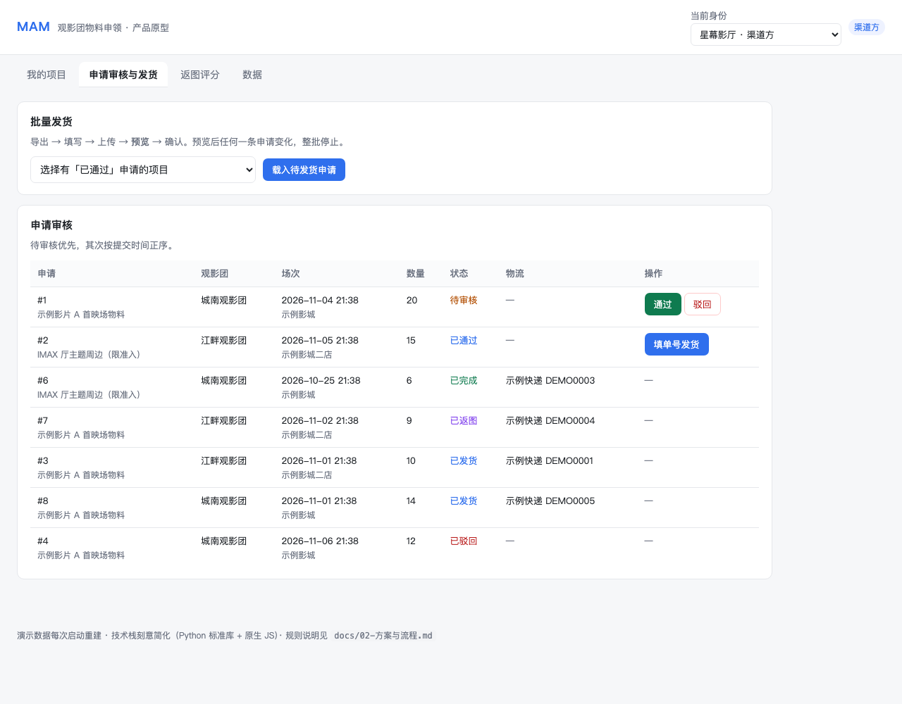
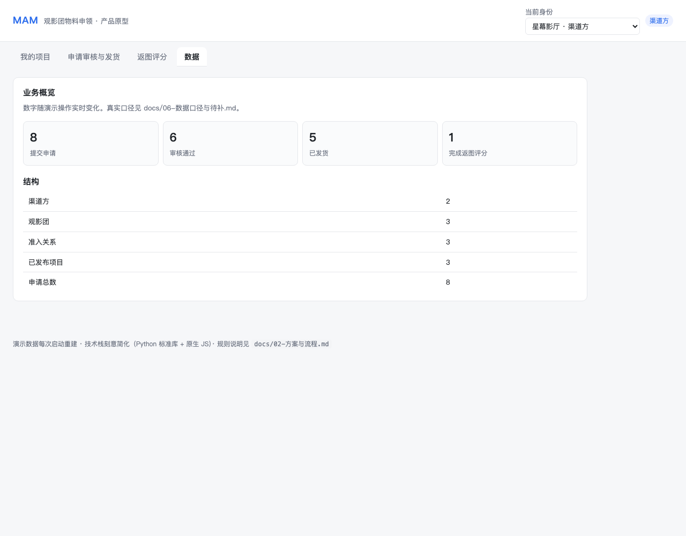

# MAM · 观影团物料申领平台

> 品牌方要给全国几十个观影团寄周边物料，原来的做法是「微信群接龙 + Excel 汇总」。
> MAM 把这套流程搬进一个有准入、有状态、可追溯的双端系统。

**我的角色**：产品负责人 —— 独立完成需求定义、规则设计、原型与验收。
**产品形态**：Web 管理端（渠道方 / 管理员） + 微信小程序（影迷 / 观影团）。
**节奏**：2026.06 一期后台骨架 → 2026.10 v1.1 双端上线。

> 这是一个**产品案例集**，不是代码仓库。这里记录的是「为什么这么设计」，不是「怎么实现」。

---

## 1. 问题：一条被微信群撑起来的业务链路

线下观影活动前，品牌方、片方、特效厅渠道方需要把海报、票根、周边物料寄给各地观影团。原链路：

```
渠道方在群里发通知 → 团长接龙 → 群里发表格 → 私聊收地址
→ 人工汇总 → 打包发货 → 群里催返图 → 返图散落在聊天记录
```

四个角色都在做重复劳动，而且没有人对「发没发、发给了谁、有没有履约」负责。拆成产品问题：

| 问题 | 具体表现 | 谁在付代价 |
|---|---|---|
| **流向不可控** | 表格或链接一转发，非目标团长也能报；同一场次重复报 | 渠道方（超发、串发，物料成本直接损失） |
| **信息不结构化** | 城市、影城、场次、数量、收货信息散在聊天里 | 团长（填错）+ 渠道方（退件、重寄） |
| **履约不可追溯** | 发货靠人记，返图靠人催，评分不沉淀 | 渠道方（无法判断这笔投放值不值） |
| **每方重复造轮子** | 每家渠道一套表格、一套催收话术 | 整个链条 |

关键观察：**这个问题不是「缺一个报名表单」，而是「缺一套流向规则」。** 表单做得再好，只要链接能被任意转发，串发就一定会发生。

---

## 2. 三个关键判断

### 判断一：先做「可控的申领通道」，不做「开放的报名平台」

最常见的做法是做一个公开的项目广场，谁都能看、谁都能报，靠人工审核兜底。我没有这么做，而是把**准入前置**：

- 渠道方认证时获得一个全平台唯一的**渠道标签**；
- 只有持标签的观影团才能看到并申请该渠道的项目；
- 新观影团通过**限次邀请码**或渠道方按注册手机号手动添加进入；
- 项目可见范围分三档：**公开 / 仅准入 / 私密**。

代价是牺牲了开放增长——观影团不能「自己发现」项目。换来的是：串发、超发在**申请发生之前**就被拦住，而不是在审核环节靠人眼识别。对一个物料成本真金白银的业务来说，这笔交换是划算的。

### 判断二：双端分工，而不是双端对等

没有做「所有角色都能用两个端」。按**任务介质**分工：

| | Web 管理端 | 微信小程序 |
|---|---|---|
| 渠道方 | 建项目、配表单、批量审核、导出、批量发货 | — |
| 管理员 | 认证审核、项目审核、系统管理 | — |
| 观影团 | 可登录，但主战场不在 Web | 申领、改申请、看物流、返图 |
| 影迷 | — | 项目广场、团体主页 |

渠道方的工作是**表格密集型**（一次几十上百条申请、Excel 导入导出），屏幕越大越好；团长的工作是**现场型**（在影城门口拍照返图、在手机上填地址），必须在小程序里。让团长用 PC 后台填表，是这类系统最常见的死法。

### 判断三：把「不可逆动作」设计成可预演、可回滚

发货是这个系统里唯一一个**离开系统就无法撤回**的动作——单号一旦填错、地址一旦发错，物料就追不回来了。所以批量发货不是「上传 Excel 直接执行」，而是：

**导出模板 → 填写 → 上传校验 → 预览 → 显式确认 → 整批事务执行**

预览之后只要有任何一条申请的状态、审核轮次、数量或收货信息发生变化，**整批停止**，必须重新预览。要么全部成功，要么全部不动。

---

## 3. 结果

| 维度 | 结果 |
|---|---|
| 双端 | Web 管理端已上线；小程序 v1.1 完成真机验收，正式发布按运营节奏安排 |
| 业务闭环 | 认证 → 项目发布 → 申请 → 审核 → 发货 → 返图评分 → 归档 |
| 权限模型 | 影迷 / 观影团 / 渠道方 / 管理员四角色，认证即授权、取消即回收 |
| 合规 | 完成网站 ICP 备案与公安联网备案，生产页面固定展示备案信息 |
| 迭代 | v1.0 跑通主流程；v1.1 补齐渠道准入、项目分享、批量发货、多图表单 |

> 业务数据（渠道数、观影团数、申请量、退件率等）不在此处编造。
> 指标定义与取数方式见 [docs/06-数据口径与待补.md](docs/06-数据口径与待补.md)，拿到真实数据后回填。

---

## 4. 可运行的产品原型

上面的规则不是写在纸上的。`demo/` 里有一个零依赖原型，一条命令就能把主流程走一遍：

```bash
cd demo
python3 app.py      # 打开 http://localhost:8000
```

不需要 pip、数据库或 Node。原型实现了三档可见范围、准入校验、动态表单预填、驳回重提、批量发货快照与整批回滚。五分钟演示剧本见 [demo/README.md](demo/README.md)。

规则不是靠人眼验证的：`python3 tests/test_api.py` 会启动临时实例跑 24 条端到端断言（含「预览后数据变化 → 整批停止」）。

> 技术栈与真实系统不同（真实为 Spring Boot + Vue + 微信小程序），这里刻意简化，只保留值得被验证的产品规则。

### 界面

| 观影团 · 项目广场 | 观影团 · 申请表自动预填 |
|---|---|
|  |  |

| 渠道方 · 申请审核与发货 | 数据漏斗 |
|---|---|
|  |  |

---

## 5. 阅读顺序

| 文档 | 内容 |
|---|---|
| [01 用户与场景](docs/01-用户与场景.md) | 四类角色、用户旅程、场景约束 |
| [02 方案与流程](docs/02-方案与流程.md) | 对象模型、状态机、准入模型、权限矩阵 |
| [03 关键决策](docs/03-关键决策.md) | 8 条决策记录：背景 / 选项 / 决定 / 代价 |
| [04 上线与放量](docs/04-上线与放量.md) | 灰度设计、合规门槛、发布与回滚 |
| [05 复盘](docs/05-复盘.md) | 做对的、做错的、没做的 |
| [06 数据口径与待补](docs/06-数据口径与待补.md) | 指标定义与取数方式 |
| [07 脱敏与版权说明](docs/07-脱敏与版权说明.md) | 本仓库的边界 |
| [demo/ 可运行原型](demo/README.md) | 零依赖 demo、五分钟演示剧本、规则与代码对照 |

---

## 6. 边界说明

本仓库是**脱敏后的产品案例**：

- 不含任何真实用户数据、企业信息、备案号、域名、服务器地址与密钥；
- 界面截图均以虚构数据重绘，与真实用户无关；
- 技术实现基于开源框架二次开发，第三方授权与出处见 [07](docs/07-脱敏与版权说明.md)。
