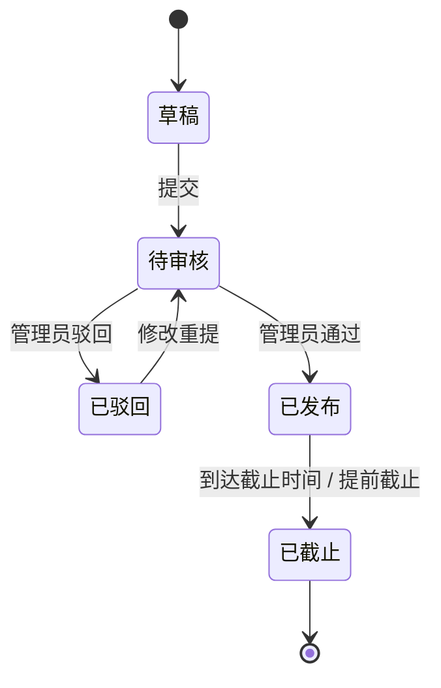
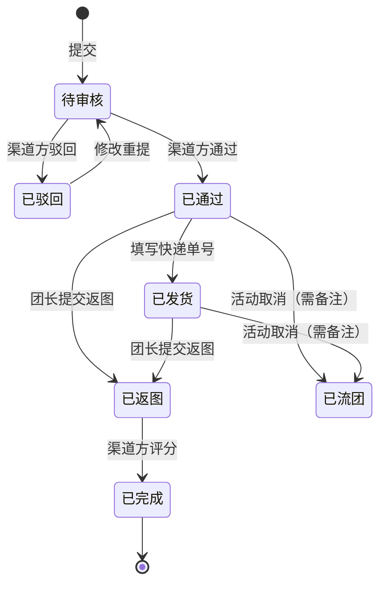

# 02 · 方案与流程

## 1. 信息架构

```
Web 管理端（渠道方 / 管理员）
├── 认证审核           管理员：观影团认证、渠道方认证
├── 项目管理           渠道方：新建 / 配置 / 分享 / 数据分析 / 发货管理
│   └── 项目配置       基础信息 · 报名表字段 · 活动成果字段 · 可见范围
├── 申请审核           渠道方：筛选 / 查看 / 通过 / 驳回
├── 返图审核           渠道方：看返图 / 评分 / 评论
├── 渠道准入           渠道方：标签 · 邀请码 · 准入名单
└── 系统管理           管理员：用户 / 角色 / 菜单

微信小程序（影迷 / 观影团）
├── 项目广场           公开项目信息流
├── 项目详情           详情 · 分享入口 · 申请表
├── 我的申请           状态 · 物流单号 · 修改重提
├── 活动返图           按成果字段提交 · 流团申请
├── 团体主页           公开资料 · 历史评分
└── 个人中心           认证 · 团资料 · 常用影城 · 常用地址
```

分工原则只有一句：**表格密集的留在 Web，现场发生的进小程序。**

---

## 2. 核心对象

| 对象 | 说明 | 关键属性 |
|---|---|---|
| 用户 | 平台账号，手机号为账号 | 角色、认证状态 |
| 观影团档案 | 认证通过后生成 | 团名、城市、公开资料、常用影城、常用地址、历史评分 |
| 渠道档案 | 认证通过后生成 | 渠道名、类型（特效厅 / 片方 / 赞助商）、唯一标签、准入名单 |
| 项目 | 一次物料投放 | 关联影片、报名窗口、可见范围、报名表配置、成果配置、状态 |
| 报名表字段 | 项目级动态配置 | 字段类型、是否必填、排序、多图数量 |
| 申请 | 一个观影团的一个场次 | 动态字段值、审核轮次、通过数量、驳回原因 |
| 返图 | 活动成果 | 按成果字段填写、图片 / 文件 / 链接 |
| 评价 | 渠道方给出的评分 | 五分制、评论、写入团体历史评分 |
| 提醒 | 站内与订阅消息 | 审核结果、发货、返图提醒、评价完成 |

一张申请表 = 一个场次。同一个项目下，一个观影团可以提交**多份**申请——这是业务上的真实需求（一个团一周可能办三场），也是数据模型上必须提前想清楚的一点：唯一键不能是「项目 + 观影团」。

---

## 3. 状态机

### 项目



规则细节：

- 待审核期间**不可编辑**，避免审核对象在审核过程中变化；
- 已发布后再修改**直接生效**，但项目名称与关联影片锁定；
- 删除只允许「本人 + 草稿 + 无申请」，且级联清理表单字段与物料图鉴；
- 已发布项目编辑后，已参与的观影团会收到变更提醒。

### 申请



规则细节：

- 只有「待审核 / 已驳回」可修改，通过后锁定内容；
- 驳回重提会清空上一轮审核备注，并携带**审核轮次**（`reviewVersion`）——通知与状态校验都必须绑定轮次，否则会出现「上一轮的通知发到了新一轮」；
- 流团必须填备注，且流团后不再展示返图入口；
- 同一项目下重复报名不拦截（代表不同场次），但同一场次重复提交需要前端与校验共同约束。

---

## 4. 准入模型

这是整个系统最核心的一块设计。

### 4.1 三个层次

| 层次 | 机制 | 解决的问题 |
|---|---|---|
| **身份层** | 观影团认证 / 渠道方认证，管理员审核 | 谁有资格参与 |
| **关系层** | 渠道标签 + 准入名单 + 限次邀请码 | 谁能参与**这个渠道**的项目 |
| **项目层** | 公开 / 仅准入 / 私密 + 分享链接 | 这个项目对谁可见 |

### 4.2 标签与邀请码

- 每个渠道方在认证时获得一个**全平台唯一**的标签，留空默认取渠道名；
- 渠道方可以按**注册手机号**精确查找已认证观影团，手动添加或恢复准入；
- 邀请码生成、启停、重置，可设有效次数；重复加入不重复消耗次数；
- 被移除的观影团**不能用邀请码自行重新加入**，只能由渠道方手动恢复；
- 移除只限制**新增报名**，已有申请与审核、发货、物流、返图等履约流程不受影响。

最后一条是刻意的：**准入是「能不能再来」，不是「以前算不算」。** 把历史履约和未来资格解耦，避免一次误操作让在途物料失去追踪。

### 4.3 可见范围与分享

| 范围 | 广场可见 | 申请条件 |
|---|---|---|
| 公开报名 | 是 | 登录 + 观影团认证 |
| 仅准入 | 是（对持标签者） | 登录 + 认证 + 持有该渠道标签 |
| 私密 | 否，仅分享链接可达 | 登录 + 认证 + 有效分享凭证 |

分享链接有两种模式：

- **仍需校验准入**：把项目推给外部，但进来的人必须已经有标签；
- **直通本项目**：给特定合作方开一个口子，**只授权这一个项目，不授予标签**。

「直通不授标签」是关键约束——否则一次分享就等于一次批量准入，前面的准入模型会被绕过。

---

## 5. 权限矩阵

| 能力 | 影迷 | 观影团 | 渠道方 | 管理员 |
|---|:--:|:--:|:--:|:--:|
| 浏览公开项目 / 团体主页 | ✓ | ✓ | ✓ | ✓ |
| 提交认证 | ✓ | — | ✓ | — |
| 审核认证 | — | — | — | ✓ |
| 维护团资料 / 常用影城 / 常用地址 | — | ✓ | — | — |
| 新建 / 配置项目 | — | — | ✓ | — |
| 项目审核 | — | — | — | ✓ |
| 提交申请 / 修改重提 | — | ✓ | — | — |
| 申请审核 / 驳回 | — | — | ✓ | — |
| 发货（单条 / 批量） | — | — | ✓ | — |
| 提交返图 / 流团 | — | ✓ | — | — |
| 评分与评论 | — | — | ✓ | — |
| 项目数据分析 / 导出 | — | — | ✓ | — |
| 渠道准入管理 | — | — | ✓ | — |
| 系统管理 | — | — | — | ✓ |

两条隐含规则：

1. **数据归属优先于角色**：渠道方只能看自己创建项目下的申请，管理员视角不展示草稿；
2. **认证即授权**：认证通过自动授予角色，取消认证自动回收。平台不开放角色配置台——运营只有一个人，任何需要「手动配权限」的设计都会变成事故来源。

---

## 6. 关键流程细节

### 6.1 申请表预填

团长维护「常用影城」与「常用收货地址」后，新申请表自动填充：

| 字段 | 取值 |
|---|---|
| 活动城市 | 团体档案城市 |
| 观影团名称 | 团体档案名称 |
| 活动影城 / 影厅 | 默认常用影城（无默认取第一个） |
| 收件人 / 电话 / 地址 | 默认收货地址（无默认取第一个） |

配置了多个影城或地址时，表单顶部出现下拉框，切换即更新对应字段。目标不是「少填几个字」，而是**把退件率压到接近零**——退件的主要来源就是地址与影城填错。

### 6.2 批量发货

```
导出 XLSX（项目全部申请）
   ↓ 渠道方填写单号
上传（校验项目归属、申请归属、单号格式）
   ↓
预览（逐条展示申请、团体、数量、收件信息、单号）
   ↓ 显式确认
整批执行（事务）
```

约束：

- 只处理「已填写单号 + 服务端状态为已通过」的申请；
- 预览结果以**一次性快照**保存（10 分钟、绑定账号与项目），确认时只能提交快照凭证；
- 快照生成后，任何一条申请发生状态、审核轮次、数量或收件信息变化，**整批停止**，需要重新预览；
- 任一发货或通知失败，整批回滚。

这不是技术上的洁癖。物流单号一旦提交，物料就已经在路上了，部分成功意味着**没人知道到底发了哪些**。

### 6.3 返图与评分

- 成果字段由渠道方在项目里配置（合影、多图、网盘链接等），默认两项必填；
- 团长只能对「已通过 / 已发货」的申请提交返图，提交后可修改；
- 渠道方看返图后给五分制评分 + 可选评论，申请归档为「已完成」；
- 评分聚合到团体历史评分，成为后续审核的参考。

第一期**没有接真实的图像识别或自动评分**，理由见 [ADR-07](03-关键决策.md)。
